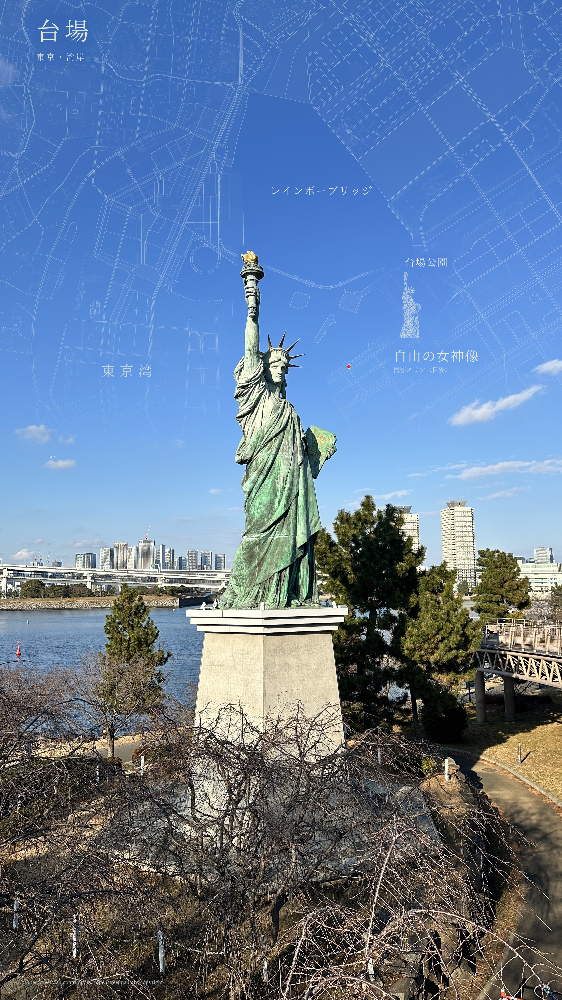
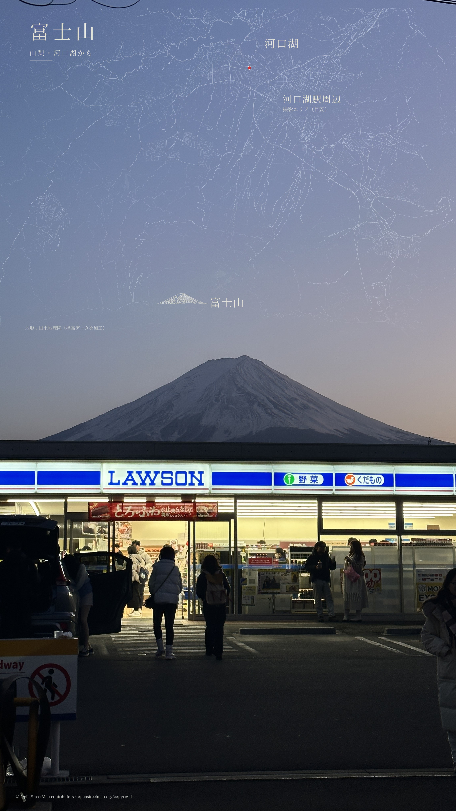
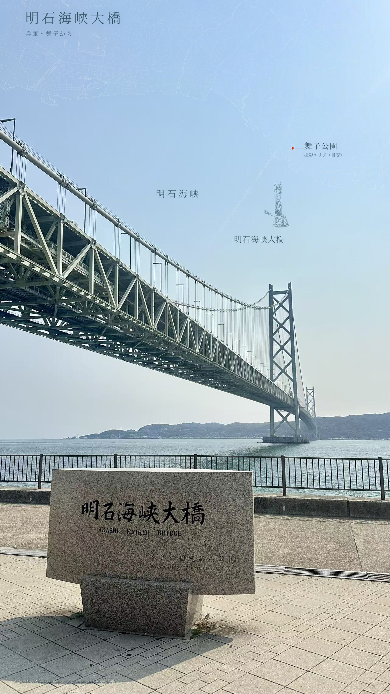
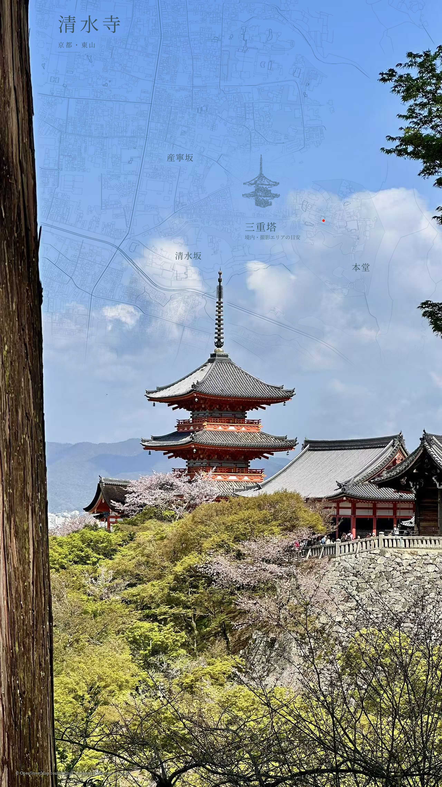
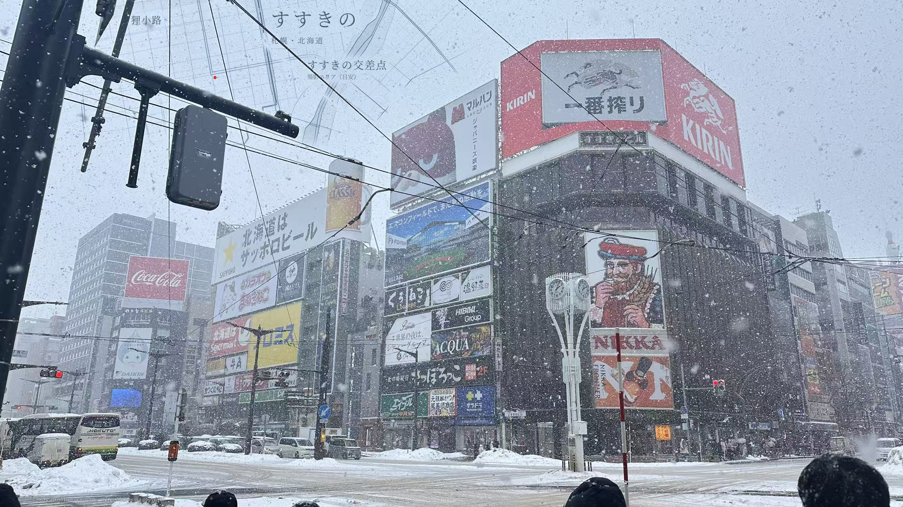
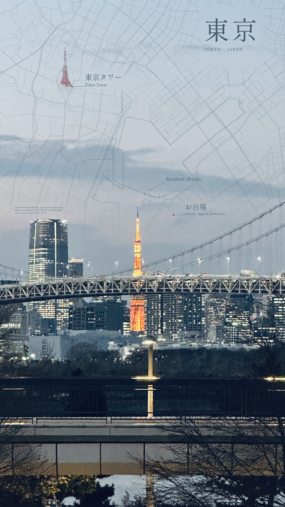
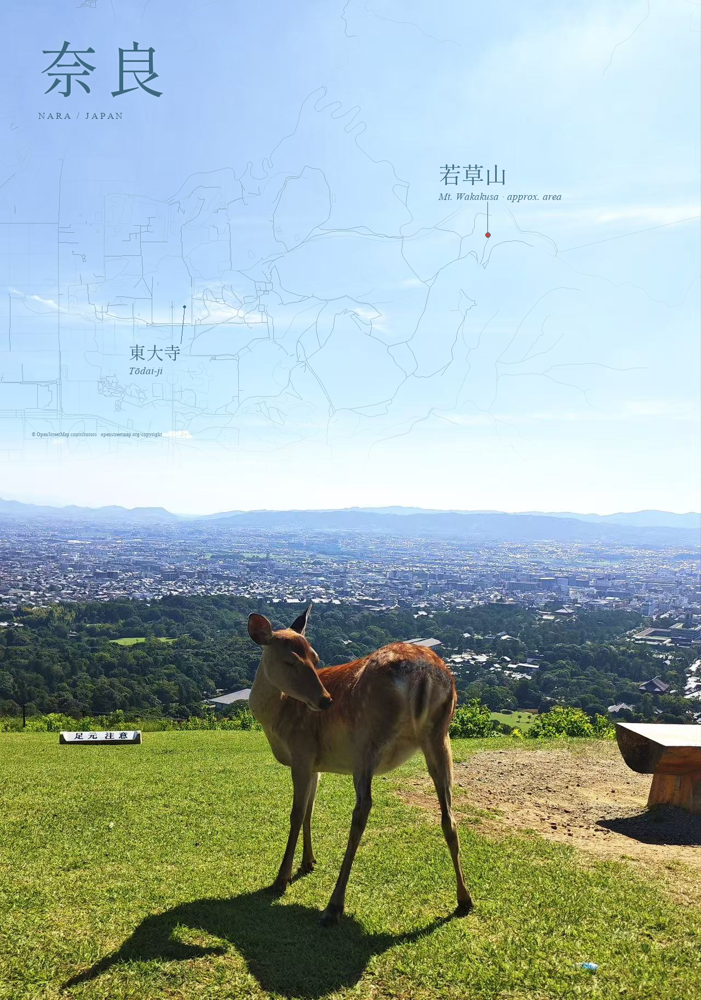

# Travel Map Postcard · 旅行地图明信片

识别旅行照片中的地点，核对真实地理数据，在天空、海面等负空间叠加独立透明地图层，制作克制的杂志风明信片。默认保留照片的完整画幅、原始尺寸、主体、色彩和光影。

An agent skill for researched location identification and editorial map overlays. The host agent handles vision and research; deterministic Python helpers retrieve and draw real geography without regenerating the photograph.

## 效果展示

当前安装版为 **v0.2.1**，加入14张日本照片制作后的构图规则和标记防消失检查。下方是已获授权的 v0.2.0 成品展示；新一批私人照片不包含在仓库或安装包中。

### v0.2.0 · 日本五景最终版

以下五张为照片提供者确认并授权展示的最终成品，展示本次细线地图、日语标注、地标线描和天空融合的修订效果。点击图片查看完整高清文件。

| 东京 · 台场自由女神 | 富士山 · 河口湖 |
| :---: | :---: |
| [](examples/odaiba-liberty-v02.jpg) | [](examples/fuji-kawaguchiko-v02.jpg) |
| 湾岸线条顺着大面积蓝天展开，保留雕像轮廓。 | 河口湖道路与真实高程线条分层，山体线描呼应原景。 |

| 兵库 · 明石海峡大桥 | 京都 · 清水寺 |
| :---: | :---: |
| [](examples/akashi-kaikyo-v02.jpg) | [](examples/kyoto-kiyomizu-v02.jpg) |
| 地图避让桥梁与缆索，保留海峡空间感。 | 调整地图对比度与云层遮淡，保留塔尖和树木前景。 |

**北海道 · 札幌薄野**

[](examples/sapporo-susukino-v02.jpg)

横构图将地图放在左上方天空，区分主路与细街道，减少重复步道造成的网格感，保留真实街区结构和雪景。

这组展示保留完整画幅，经过照片局部轻度清晰增强后与地图合成，再做 2× Lanczos 放大；属于高清展示导出，不是 AI 超分辨率。富士山等高线和照片派生地标线描使用本地辅助处理，当前安装包不包含通用等高线或自动线描提取器。地图数据、处理说明与图片授权见 [案例署名](examples/CREDITS.md)。

### 早期案例

| 东京 · 台场 | 奈良 · 若草山 |
| :---: | :---: |
| [](examples/tokyo-odaiba.jpg) | [](examples/nara-wakakusa.jpg) |
| 蓝灰地图融入阴天天空，实拍塔体标记突出地标。 | 纯线稿顺着背景光微微发光，不加地形色块。 |

点击图片查看完整分辨率。台场展示图另做了经授权的轻度原片修复，该步骤不属于 skill 的默认合成处理。两张案例均使用真实地图，拍摄区域标注为近似位置；图片来源与许可见 [案例署名](examples/CREDITS.md)。

## 安装

需要 Python 3.10+、Pillow，以及具备看图、联网检索和本地执行能力的 agent。无需图像生成 API 密钥；地图接口由使用者选择并遵守其服务条款。

**直接安装：** 从 [Releases](https://github.com/niuzipai-gif/travel-map-postcard-skill/releases/latest) 下载 `travel-map-postcard-v0.2.1.zip`，解压后将 `travel-map-postcard` 文件夹放入 agent 的 skills 目录。Codex 通常为 `~/.codex/skills/`；Windows 通常为 `%USERPROFILE%\.codex\skills\`。如果已有同名 skill，先备份再替换。

在解压得到的 skill 文件夹内安装依赖：

```bash
python -m pip install -r requirements.txt
```

**从源码安装：** 克隆本仓库，将 `skills/travel-map-postcard/` 复制到上述 skills 目录，再安装其中的 `requirements.txt`。

字体使用本机已获许可的字体，不随包分发。当地语言标题需要覆盖相应字形；缺字会明确报错，可通过 `--font` 指定兼容字体。

## 使用

附上旅行照片并输入：

> 使用 $travel-map-postcard 把这张旅行照片做成克制的杂志风地图明信片。先自动识别并核对地点，使用真实地图；完整保留原片，用独立透明图层合成。日本的标题和地图标注用日语，韩国用韩语，其他地区默认英语。线条细腻，地图核心在手机宽度仍清晰，地标线描保留真实结构，避开主体和文字。没有准确 GPS 就用相应语言标大致区域。成品文件夹每张只留最终图片，母版和透明层单独归档。

可以补充地点线索、偏好的配色或已知机位。当地标与机位不一致时分别记录；地点歧义会影响地图选择时，agent 会询问必要线索。识别结果是有来源支持的推断，不是精确相机定位。

## 视觉与交付

- 地图来自真实道路、海岸、建筑轮廓或步道；保持北向向上和等比投影，不编造等高线、路线或坐标。
- 重要轮廓与核心主路更清楚，外围细节更轻；可根据原片光源方向设置柔和微光。标题与主体留出空间。
- 日本全套地理标注用日语，韩国用韩语，其他地区默认英语；用户指定优先，副标题不强制加英文。一组照片保持相近的标题节奏和层次。
- 工作区保存原始显示尺寸的无损 `postcard.png`、全画幅透明 `map-overlay.png`，以及配置、来源、哈希与验收结果。原始文件不覆盖。用户目录只留每张最后接受的一份最终图片，过程文件和重复格式放到目录外。
- 默认合成验证覆盖透明层之外及指定保护区域的像素不变，并检查合成结果可被独立重建。另行授权的照片修复属于不同处理，不宣称仍满足原片像素不变。

纯线稿可独立使用。可选的真实航拍与建筑实拍符号分别保留图层，按来源记录地理范围或地标位置。微调重点实景时可以只适配该实景的透明度，保持线稿和源 RGB 不变。建筑实拍符号明确为不按地图比例的标记。

日本 GSI 小范围航拍有内置下载器；其他地区需要适合且有来源的影像，不承诺全球高清覆盖。背景同色相纹理化为可选处理，只作用于影像图层，并记录处理方式。参见 [微光与实景](skills/travel-map-postcard/references/glow-and-aerial.md)。

### v0.2.1：14张日本照片带来的改进

- 按大天空、狭窄天空、密集街景和室内展品选择构图，允许利用现有无字墙面或招牌背面；紧凑地图需明确阅读限制。
- 在真实地图范围检查之后，新增投影裁切检查和最终图层红点检查，避免标注有字无点、点被树冠或主体遮罩盖住。
- 预览总览与交付使用同一份逐图版本清单，不按文件夹最新版本自动挑图。
- 地点确认区分被摄地标、拍摄区域与精确机位；地图缓存核对真实覆盖范围，下载失败不以假地图替代。
- 清晰增强与地图合成分层，记录原始及导出尺寸；4096像素插值导出不称为细节恢复。

以上包含通用说明与两项渲染检查。自动线描提取、任意形状遮罩辅助工具及高清导出仍是逐图制作步骤，不是安装包已具备的一键功能。

### v0.2.0：从实际修订中固化的改进

- “细”和“看得见”分别检查：去掉粗描边，按天空明暗调整线色与局部透明度，避免京都或雪景地图被多重淡化吞掉。
- 新增 `highway_styles` 道路分级，并修正默认城市模式遗漏步道过滤的行为；主路覆盖次级道路，水系与海岸保持优先，不把真实街区改成假地图。
- 近似区域标注支持日语、韩语，仍要求可见说明、地点证据与估计范围。
- 地标线描要保留可辨识结构；高清处理与地图分层，插值放大不冒充细节恢复。
- 逐张选择已接受版本，最终图片与工作档案分开，清理时不按同名地点误删不同照片。

完整操作与验收要点见 [细化与交付指南](skills/travel-map-postcard/references/refinement-and-delivery.md)。这些视觉规则需要逐图审查；自动脚本不替代艺术判断。

## 脚本与资料

从 skill 文件夹运行：

```bash
python scripts/postcard.py inspect /path/to/photo.jpg
python scripts/postcard.py render --photo /path/to/photo.jpg --map /path/to/map.json --config /path/to/composition.json --out /path/to/new-version
python scripts/postcard.py verify --photo /path/to/photo.jpg --out /path/to/new-version
```

Windows 如遇默认编码问题可使用 `python -X utf8`。取数前阅读 [地图来源](skills/travel-map-postcard/references/maps.md)；配置字段与示例见 [配置说明](skills/travel-map-postcard/references/config.md)。下载有范围限制和本地缓存；不向地图服务上传原照片。

## 验证与范围

在仓库根目录运行：

```bash
python -m unittest discover -s tests -v
```

50 项测试使用合成数据，无需私人照片或实际网络请求。版本验证和本地制作经验摘要见 [TESTING.md](TESTING.md)。自动检查证明的是技术行为，视觉质量与地点判断需要另行核对。

Windows 已实际验证；macOS/Linux 字体查找有实现，但未在这两个系统上实际验证。没有独立视觉定位模型、DEM/等高线生成器或通用高清修复模块。公共地图服务不保证生产可用性。CMYK 或带透明通道的照片输入会明确拒绝。

## 许可与隐私

代码和文档采用 [MIT](LICENSE)。照片、字体、地图及航拍数据遵守各自许可；OSM 数据为 ODbL，输出保留相应署名与许可链接。航拍和实拍符号另需保留来源、编辑说明及其许可要求。

安装 ZIP 仅含 skill 通用说明、代码和软件许可。仓库另含合成测试，以及经提供者授权展示的七张成品（新版日本五景和两张早期案例）；案例图片不适用代码和文档的 MIT 许可，具体来源见 [案例署名](examples/CREDITS.md)。原始照片、未授权作品、地图下载缓存、私人配置及密钥不公开。
